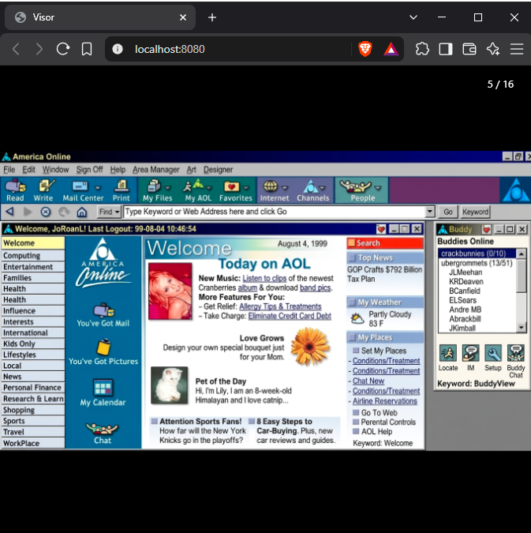
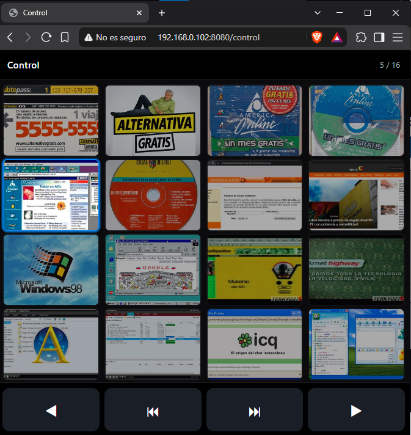
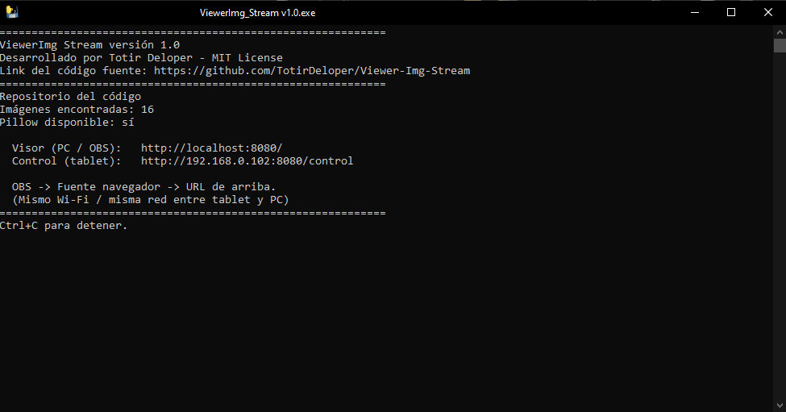

# 📷 Visor de Imágenes con Control Remoto para OBS

Servidor ligero en **Python** que muestra imágenes a pantalla completa en tu PC (o en OBS) y permite controlarlas desde una **tablet** en tiempo real, todo desde el navegador.

- 🖥️ **PC / OBS** → imagen a pantalla completa en `http://localhost:8080/`
- 📱 **Tablet** → panel de control con miniaturas en `http://<IP-PC>:8080/control`

Sincronización instantánea entre ambos mediante **Server-Sent Events (SSE)**. Sin frameworks, sin dependencias obligatorias y sin build.

---

## ✨ Características

- **Sincronización en tiempo real** entre tablet y PC vía SSE.
- La tablet ve **miniaturas y botones grandes**; el PC ve la **imagen a pantalla completa**.
- Funciona como **Browser Source** en OBS: `http://localhost:8080/`.
- Miniaturas generadas al vuelo si tienes **Pillow** instalado (opcional).
- Control por **teclado** desde el PC (← / → / Home / End).
- **Un solo archivo Python**, sin `pip install` obligatorio.
- Detecta automáticamente las imágenes nuevas de la carpeta al recargar el control.

---

## 📁 Estructura del proyecto

```text
visor-imagenes/
├─ servidor.py
├─ README.md
├─ LICENSE
└─ img/
   ├─ foto1.jpg
   ├─ foto2.png
   └─ ...
```

Solo necesitas **`servidor.py`** y la carpeta **`img/`** con tus imágenes dentro.

---

## 🚀 Instalación

### Requisitos

- **Python 3.10.8** o superior.
- **(Opcional, recomendado)** `pip install pillow` para miniaturas rápidas en la tablet.

### Pasos

```bash
git clone https://github.com/TuUsuario/visor-imagenes.git
cd visor-imagenes
```

Coloca tus imágenes dentro de la carpeta `img/`.

---

## ▶️ Uso

```bash
python servidor.py
```

Salida esperada:

```
============================================================
Imágenes encontradas: 5
Pillow disponible: sí

  Visor (PC / OBS):   http://localhost:8080/
  Control (tablet):   http://192.168.1.42:8080/control
============================================================
```

- En el **PC** se abre automáticamente el visor a pantalla completa.
- En la **tablet** abre `http://<IP-DE-TU-PC>:8080/control` (usa la IP que muestre el servidor).
- Toca una miniatura → el PC cambia al instante.
- Flechas **← / →** y los **4 botones inferiores** también funcionan.
- Cambia de imagen desde el teclado del PC → la tablet se sincroniza igual.

### 🎬 Integración con OBS

1. Añade una fuente **Navegador**.
2. URL: `http://localhost:8080/`.
3. Listo. Puedes usar la tablet como **mando remoto** mientras OBS muestra la imagen.

### ⚠️ Notas importantes

- **Tablet y PC deben estar en la misma red Wi-Fi** (no invitados, no AP aislado).
- **Firewall de Windows:** la primera vez te pedirá permitir Python en la red privada. Acepta.
- Si cambias el puerto, edita `PUERTO = 8080` al inicio de `servidor.py`.
- Si añades imágenes nuevas con el servidor corriendo, recarga `/control` en la tablet.

---

## ⚙️ Configuración rápida (`servidor.py`)

```python
PUERTO = 8080
CARPETA_IMG = Path("img")
ABRIR_NAVEGADOR = True
EXTENSIONES = {'.jpg', '.jpeg', '.png', '.gif', '.webp', '.bmp', '.avif', '.svg'}
```

---

## 🎨 Personalización

- **Tamaño de miniaturas (servidor):** ajusta `im.thumbnail((320, 320))` en `_servir_thumb`.
- **Estilos del visor y del control:** están embebidos en `servidor.py` como `PAGINA_VISOR` y `PAGINA_CONTROL`.
- **Atajos de teclado:** modifica los listeners en las mismas constantes.

---

## 📸 Capturas del Proyecto

### 🖥️ En Navegador (Modo Visor)


### 📱 En Modo Control (Tablet)


### 💻 En Consola


--

## 🧰 Tecnologías

- Python 3.10.8 (`http.server`, `threading`, `queue`)
- Server-Sent Events (SSE) para sincronización en tiempo real
- HTML5 · CSS3 · JavaScript vanilla en las páginas servidas
- Pillow (opcional, solo para miniaturas)

---

## 📄 Licencia

Distribuido bajo la **Licencia MIT**. Consulta [`LICENSE`](LICENSE) para más información.

Copyright (c) 2026 **Totir_Deloper**

---

## 🤝 Contribuciones

Las PRs e issues son bienvenidos. Si algo no funciona en tu setup, abre un issue con:

- Sistema operativo
- Versión de Python
- Navegador usado (tablet y PC)
- Logs o capturas

---

## ⭐ ¿Te sirvió?

Dale una estrella al repo y compártelo con quien lo necesite. ¡Gracias!
